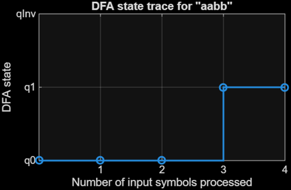
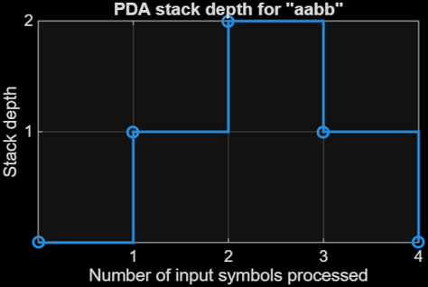
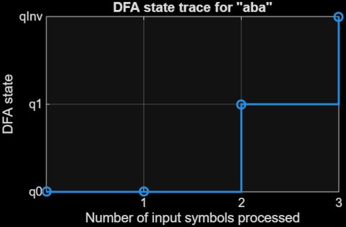
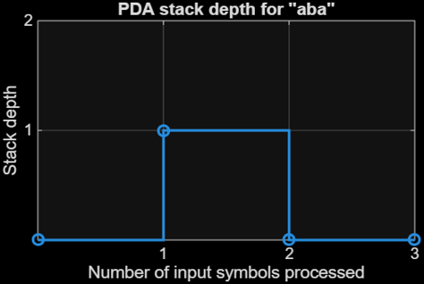
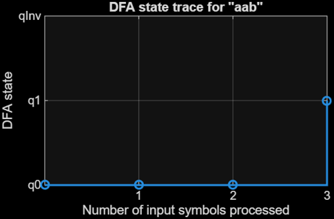
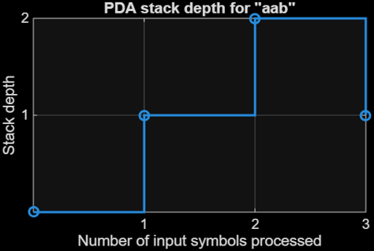

## Introduction
Can we use computation and mathematical proof to understand why some languages can be recognized by simple machines, while others require more powerful computational models?

The language in question is $L=\left\lbrace a^n b^n \;|\;n\ge 0\right\rbrace$. $L$ accepts all words that consist of only $a$'s and $b$'s, where all $a$'s come before all $b$'s and there are an equal number of $a$'s and $b$'s (e.g. $\epsilon$ (empty set), $ab$, $aaabbb$, etc.). A canonical word is $a^nb^n$, consisting of by concatenating $n$ copies of $a$ with $n$ copies of $b$.

We will be comparing the computational ability of deterministic finite-state automata (DFA) and pushdown automata (PDA).

This project investigates $L$ through three complementary approaches: simulating DFA and PDA machines in MATLAB, proving the correctness of the language recognizer in Lean, and mathematically establishing that $L$ is not regular. Together, these approaches illustrate the difference between implementing a recognizer and proving the computational limitations of a particular model.

## MATLAB PDA Recognizer
The language recognizer built in MATLAB (``MATLAB/recognizeAnBn.m``) recognizes words that belong to $L$, printing whether it accepts or rejects the word depending on whether it matches the definition of $L$. The current file contains a list of test words to run the recognizer on. The recognizer is a PDA that adds a marker to the memory stack for every $a$ and removes one for every $b$. If the input ends with the stack empty and the letters appeared in the correct order, the word is accepted.

A PDA can recognize $L$ by using its stack memory to track the number of $a$'s and $b$'s. In contrast, no DFA can recognize $L$ as shown by the arguments below.

## Lean Formalization of Correctness
``Lean/Basic.lean`` verifies that the mathematical recognizer for $L$ correctly recognizes *all* words in $L$ and correctly rejects *all* words not in $L$ instead of relying on individual test cases in MATLAB. ``Basic.lean`` does this through the function ``isInLanguage``, which checks that a word matches the definition of $L$: all $a$'s come before all $b$'s and the $a$ and $b$ counts match.

The proof that the recognizer is correct requires proving individual mathematical facts about symbol counts, concatenation, and repeated symbols for any given word in $L$. The full proof is in ``Basic.lean``. The following table includes some important lemmas to the proof:

|Important Lemmas|Mathematical Claim|
|---|---|
|``accepted_words_correct_order``|Accepted words must satisfy the ordering condition (all $a$'s come before all $b$'s).|
|``accepted_words_eq_counts``|Accepted words much have equal counts of $a$'s and $b$'s.|
|``ordered_word_blocks``|A word that satisfies the ordering condition can be broken into two blocks consisting of all $a$'s and all $b$'s.|
|``ordered_equal_counts_implies_canonical``|A word that satisfies the ordering condition and that has equal $a$ and $b$ counts is canonical.|
|``canonicalWord_in_language``|Every canonical word is accepted.|
|``accepted_word_is_canonical``|Every accepted word is canonical.|
|``recognizer_correct``|Combines both directions into the final correctness theorem|

The key result is a proof of both directions of the equivalence. Every accepted word is canonical, and every canonical word is accepted:

The lemma ``recognizer_correct`` combines these directions as the final step of the proof, proving the full equivalence between acceptance by the recognizer and membership in $L$.

## Comparing Finite-State and Stack Memory
We can compare how DFA and PDA recognize $L$ by tracing the DFA state and PDA stack depth. By comparing the results from inputs that are valid in $L$ and invalid in $L$, we can explore the limitations of computation using these memory types.

The above graphs track the memory states for the DFA and PDA for the word $aabb$. In the DFA state trace, $q_0$ or $q_1$ are valid end states, while in the PDA stack trace, a valid word must reach depth zero at the final symbol. In this case, the word belongs in $L$, so both automata accept $aabb$.

These graphs track the memory states for the DFA and PDA for the word $aba$. In this case, the word does not belong in $L$ because there are uneven counts of $a$'s and $b$'s, and it does not follow the structure $a^*b^*$, so both automata reject $aba$. The DFA enters its invalid state and the PDA detects the invalid transition back to an $a$ after beginning to read $b$'s.

These graphs track the memory states for the DFA and PDA for the word $aab$. In this case, the word does not belong in $L$ only because there are uneven counts of $a$'s and $b$'s. The PDA correctly rejects $aab$ because there is one marker left in the stack after the end of the input. However, the DFA incorrectly accepts $aab$ because it only checks the order of the symbols, which highlights the limitations of using a DFA to recognize a language.

The results from the DFA and PDA do not exact match because the PDA recognizes $L$, while the DFA recognizes a superset of $L$: $R=\left\lbrace a^i b^j \;|\;i,j\ge 0\right\rbrace$. In $R$, the letters have to be in the correct order, but their counts do not have to match. For the DFA to recognize $L$, it would have to have arbitrarily many states ($q_0:\epsilon$, $q_1:a$, $q_2:aa$, etc.), because to determine whether the $a$ and $b$ counts match, each unique number of $a$'s would have to be stored in a unique state. For this reason, no finite-state automaton would be capable of recognizing all words in $L$. A more complete proof of this fact is contained below.

### Results Summary
|Input|In $L$|In $R$|PDA for $L$|DFA for $R$|
|---|---|---|---|---|
|$aabb$|Yes|Yes|Accept|Accept|
|$aab$|No|Yes|Reject|Accept|
|$aba$|No|No|Reject|Reject|

### Why a DFA Cannot Recognize $L$ Correctly for Every Possible Word:

Suppose there exists a DFA for $L$ that has $k$ states. Consider the $k+1$ prefixes $\epsilon, a, a^2, a^3, ..., a^k$. Since there are more prefixes than states, the pigeonhole principle guarantees there must be at least two distinct prefixes that reach the same state in the machine. Call these prefixes $a^i$ and $a^j$, where $i<j$.

Appending the suffix $b^i$ to these prefixes results in the words $a^ib^i$ and $a^jb^i$. The word $a^ib^i$ belongs in $L$ by the definition of $L$ because it contains exactly $i$ copies of $a$ followed by $i$ copies of $b$. However, $a^jb^i$ does not belong in $L$ because $j>i$, so the word contains more copies of $a$ than $b$.

Since the DFA is in the same state after either prefix $a^i$ or $a^j$, reading the same suffix $b^i$ must produce the same behavior because a DFA's transitions depend only on its current state and the input symbol. However, one word belongs in $L$ and the other does not, resulting in a contradiction because the automaton cannot correctly classify both words. Therefore, no DFA can recognize $L$ correctly for every possible input string.

This proof is a Myhill-Nerode-style argument showing that $L$ has an infinite distinguishing set.

## Proof That $L$ is Not Regular
As seen previously, no DFA can recognize $L$. We proved this through properties of DFAs by showing that the computational ability of a DFA is not enough to recognize $L$, but this can also be shown through properties of $L$. The following proof is an independent proof that shows that $L$ is not a regular language:

We prove by contradiction that $L=\left\lbrace a^n b^n \;|\;n\ge 0\right\rbrace$ is not a regular language.

Suppose $L$ is regular. By the pumping lemma, there exists a pumping length $p\ge1$ such that every string $s\in L$ with $|s|\ge p$ can be written as $s=xyz$, satisfying:

1. $|xy|\le p$
2. $|y|>0$
3. $xy^iz\in L$ for every integer $i\ge0$

Choose $s=a^pb^p$, which belongs in $L$ and has length of at least $p$. Since the first $p$ symbols of $s$ are all $a$'s and $|xy|\le p$, the substring $y$ consists entirely of one or more $a$'s. Setting $i=0$ removes $y$, leaving fewer than $p$ $a$'s but still exactly $p$ $b$'s.

Therefore, $xz\notin L$, because the strings in $L$ must have equal numbers of $a$'s and $b$'s.

This contradicts the requirement that $xz\in L$ for every integer $i\ge 0$.

Hence, $L$ is not regular. $\square$

By the definition of a regular language, a language is regular if and only if it can be recognized by a DFA. Therefore, since $L$ is not a regular language, it cannot be recognized by a DFA.

## Conclusion
This project investigated the language $L=\left\lbrace a^n b^n \;|\;n\ge 0\right\rbrace$ using MATLAB simulations, formal verification in Lean, and mathematical proofs about the limitations of DFAs in recognizing languages.

The MATLAB simulations showed the differences between finite-state and stack-based memory. The DFA recognized the regular language $R=\left\lbrace a^i b^j \;|\;i,j\ge 0\right\rbrace$, which requires the $a$'s to come before the $b$'s, but does not require their counts to match. The PDA pushes a stack marker for each $a$ and removes one for each $b$, so it was able to check both the ordering and equality conditions. Comparing inputs such as $aab$ demonstrated why the DFA's finite-state memory is insufficient to recognize $L$.

The Lean formalization provided a complementary form of verification. By proving that a word is accepted if and only if it has the canonical form $a^nb^n$, the project established the correctness of the formal recognizer for all words, rather than relying on a finite collection of MATLAB test cases. The mathematical arguments then established that $L$ is not regular. Both the pigeonhole argument and the pumping lemma show that no DFA can recognize $L$.

These results demonstrate that implementing a recognizer, verifying its correctness, and proving the limits of a computational model are different but complementary tasks. MATLAB made the behavior of the machines observable, Lean allowed the recognizer's correctness to be checked formally, and the theoretical proofs explained the reasoning for why the differences illustrated in the simulations between finite-state and stack-based memory matters. This project connects computational experiments with the mathematical theory of formal languages and automata.